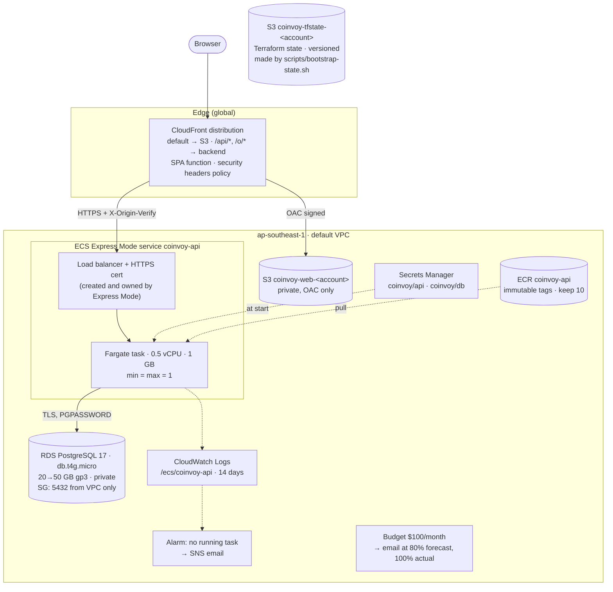
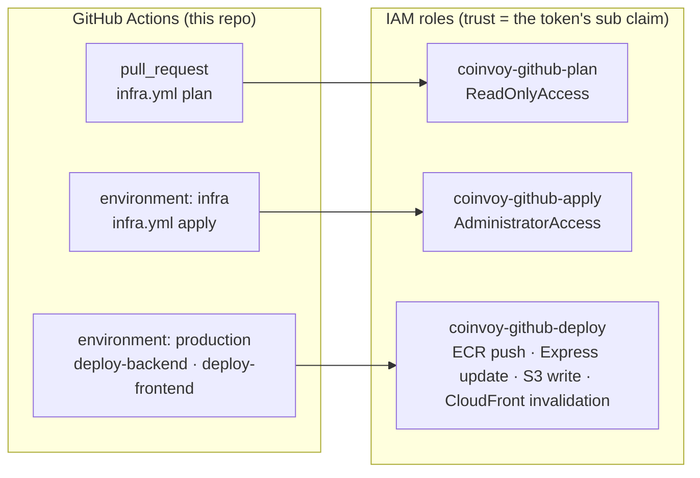
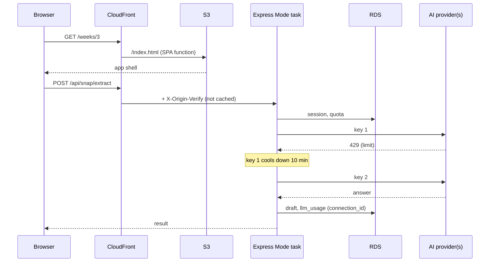

# Coinvoy infrastructure (Terraform)

Everything Coinvoy runs on in AWS (`ap-southeast-1`, Singapore) is in one root module: [`main.tf`](main.tf). Plain app settings are in [`app.auto.tfvars`](app.auto.tfvars). There are no secret values in either file, and none in Terraform state.

First-time setup and deploys are in the root [README → Deployment](../README.md#deployment). This page covers what gets built, what it costs, and how to run it.

## What gets built

| Resource | Why it's set up this way |
|---|---|
| CloudFront | One public address for the app and the API, so the session cookie is first-party and there's no CORS. Paths with no file extension get `index.html` from a CloudFront Function (deep links), applied only to the S3 behaviour, so the API's real 404s stay 404s. |
| S3 (app) | Private; only this distribution can read it (Origin Access Control). The deploy workflow sets `Cache-Control`: hashed assets for a year, everything else `no-cache`. |
| ECS Express Mode | AWS's replacement for App Runner. It creates and runs the load balancer, certificate, security groups and scaling, with about 30 lines of Terraform. Fixed at **one task**, because payday reminders run on a timer inside the API and migrations run at startup. |
| `X-Origin-Verify` | The Express Mode address is public. CloudFront adds a random header, and the API refuses `/api` and `/o` requests without it, so nobody can go around CloudFront. `/api/health` stays open for the load balancer. |
| RDS | No public address. It only accepts connections from inside the VPC, TLS is required, and the app verifies the certificate with Amazon's CA, which is built into the image. 7-day backups with point-in-time restore, deletion protection, final snapshot, storage encrypted. Storage grows by itself to at most 50 GB. |
| `coinvoy/db` | The database password. It's generated by an `ephemeral "random_password"` and written to RDS and this secret with **write-only** arguments, so it never appears in state or in a plan. ECS passes it to the task as `PGPASSWORD`. |
| `coinvoy/api` | Values you set with the CLI: `AI_KEYS_MASTER_KEY`, Google, push, `ADMIN_EMAILS`. Every key listed in `secret_keys` must exist in it, or the task won't start. |
| AI provider keys | Not in AWS config at all: admins manage them in the app (`/admin/ai`). They're encrypted in the database with `AI_KEYS_MASTER_KEY`. |
| ECR | One image per commit, with tags that can't be overwritten. The last 10 are kept for rollback. Scanned on push. |

## Who can change what (GitHub OIDC)

No AWS keys are stored in GitHub. Each role trusts exactly one kind of job. Both environments are limited to `main`, and the workflows also refuse to run unless the repository owner started them.

## How a request flows

## Running it

| Task | How |
|---|---|
| Change infrastructure | Pull request touching `infra/` (the plan shows in the run summary), merge, then **Actions → Infra (Terraform) → Run workflow** |
| Change a plain setting | Edit `app.auto.tfvars`, then apply as above |
| Change a secret value | Secrets Manager console → `coinvoy/api` → Edit, then **Deploy backend** (the task reads secrets when it starts) |
| New database password | Raise `db_password_version`, apply, then **Deploy backend** |
| AI key expired or out of quota | `/admin/ai` → Edit the connection (new key, tested on save), or add another one to the job's list. No deploy needed |
| Roll back the backend | `aws ecs update-express-gateway-service` with an earlier image tag (ECR keeps 10), or re-run **Deploy backend** on an older commit |
| Logs | CloudWatch → Log groups → `/ecs/coinvoy-api` (one JSON line per request; filter by `level`, `msg`) |
| Restore the database | RDS → `coinvoy` → Actions → Restore to point in time (creates a new instance; point `DATABASE_URL` at it by importing or renaming) |
| Tear down | Set `deletion_protection = false` and apply, then `terraform destroy`. RDS leaves a final snapshot `coinvoy-final`; delete it by hand if you don't want it |

## Cost

This is an estimate for on-demand prices in Singapore (`ap-southeast-1`) for one month (730 hours) at hackathon traffic. AWS prices change, so check the [AWS Pricing Calculator](https://calculator.aws/) before relying on it.

| Item | Basis | ≈ USD / month |
|---|---|---|
| Fargate task | 0.5 vCPU × ~$0.0506/h + 1 GB × ~$0.0055/h | 22.5 |
| Load balancer (Express Mode) | ~$0.0252/h + ~0.5 LCU | 21 |
| Public IPv4 addresses | $0.005/h each: load balancer (one per AZ, 3) + task (1) | 14.6 |
| RDS db.t4g.micro | ~$0.025/h, single-AZ | 18.3 |
| RDS storage | 20 GB gp3 (backups up to the database's size are free) | 2.8 |
| Secrets Manager | 2 secrets × $0.40 | 0.8 |
| CloudWatch | Logs (~0.5 GB ingested, 14 days) + 1 alarm | 0.5 |
| ECR | ~10 images × ~0.4 GB | 0.4 |
| S3, CloudFront, SNS, Budgets | CloudFront's always-free tier covers 1 TB and 10 M requests a month | ~0 |
| **Total** | | **≈ 80** |

The budget alert is set to **$100 a month**. It emails at 80% of the forecast and again at 100% actual, so you hear about it before the month ends.

Ways to make it cheaper, from biggest saving to smallest:
- **New-account credits.** New AWS accounts get up to $200 in Free Tier credits for the first months.
- **RDS reserved instance.** One year with no upfront payment is about 30% off the database.
- **Arm (Graviton) Fargate.** Set `cpu_architecture = "ARM64"` and build the image on an Arm runner, for about 20% off the task.
- **The load balancer and IPv4 addresses (about $35) are the cost of ECS Express Mode.** Lightsail containers or a single small EC2 instance would avoid them, at the price of the managed HTTPS and deploys.

## Runaway-cost check

The whole codebase and configuration were checked for anything that could loop or scale on its own and run up a bill:

| Risk | Status |
|---|---|
| Autoscaling | Off: the task count is fixed at min = max = 1, so it can't scale out under load. A flood makes it slow, not expensive. |
| Crash loop on deploy | Still only one task at a time; Fargate bills per second. The deploy workflow waits for health and stops there. |
| NAT gateway (~$45/month) | Not used: the task runs in the default VPC's public subnets. |
| Database storage | Grows by itself, but never past 50 GB (`max_allocated_storage`). |
| Logs | Kept 14 days, so storage can't build up. |
| ECR images | The last 10 are kept. |
| CloudFront invalidations | One `/*` per frontend deploy. The first 1,000 paths a month are free. |
| GitHub Actions | No scheduled workflows. Deploys and applies only run when the owner starts them. |
| Reminder timer | Every 15 minutes, one database query; it does nothing if push isn't configured. |
| AI fallback | At most 6 connections per job and 1 SDK retry each. A rate-limited key is skipped for 10 minutes instead of being retried. Odah Bot's tool loop is capped at 4 rounds. Per-rider daily caps and `LLM_MONTHLY_CALL_CAP` still apply. (These charges are on the AI provider, not AWS.) |
| Frontend | No polling (no `refetchInterval`). The chat stream loop ends when the response does. |
| **Bot flood through CloudFront** | **The one open risk.** Requests past the free 10 M a month cost about $0.01 per 10,000, and each `/api` request also uses load balancer capacity. Nothing blocks it except the per-IP limits on sign-in and admin. The budget alert tells you; it doesn't stop it. If that's a worry, add an AWS WAF rate-based rule on the distribution (about $6 a month plus $0.60 per million requests). |
